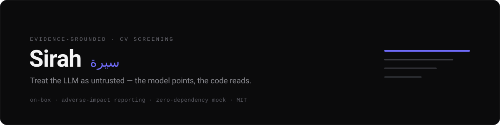
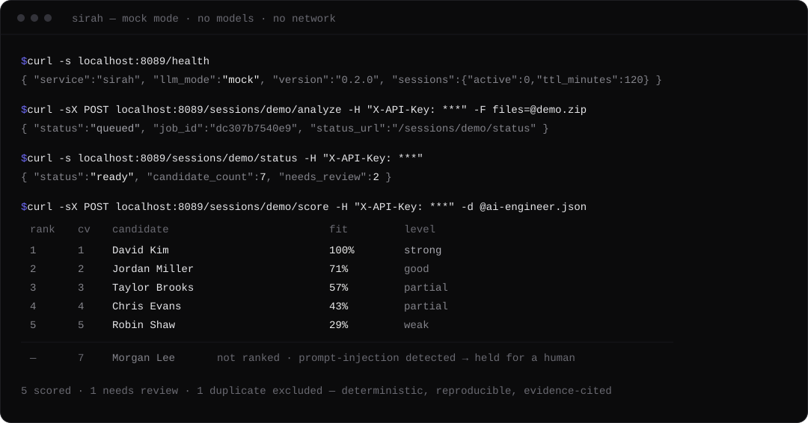
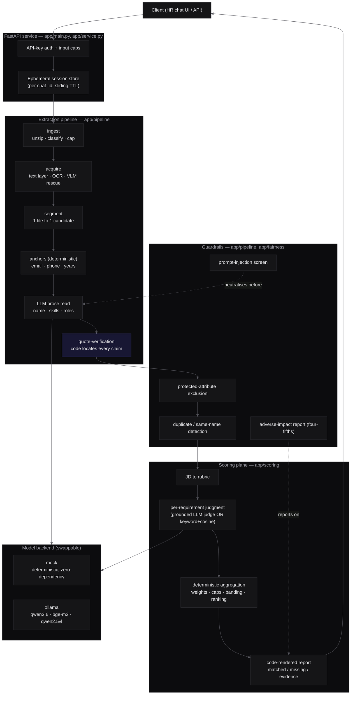

<div align="center">



<br/><br/>

[](https://github.com/Almehmadi-Ai/sirah/actions/workflows/ci.yml)
[](https://github.com/Almehmadi-Ai/sirah/actions/workflows/security.yml)


<p><b>Evidence-grounded, on-box CV screening that treats the LLM as an untrusted component.</b><br/>
A batch of résumés and a job description in; a ranked fit report out, with every claim cited to the page it came from.<br/>
<sub><i>Sirah</i> (<span dir="rtl">سيرة</span>) is Arabic for the account of a life: a résumé.</sub></p>

</div>

---

A FastAPI service that reads PDF, Word and image CVs in Arabic and English,
extracts grounded candidate profiles, scores them against any job description,
and reports adverse impact (four-fifths rule) from group labels the operator
supplies. Models run on a local Ollama; the default `mock` backend runs the whole
pipeline with no model, no GPU and no network.

## Quick start

Python 3.11+. Everything below runs in the default `mock` mode.

```bash
python -m venv .venv
source .venv/bin/activate                   # Windows: .venv\Scripts\activate
pip install -e ".[dev]"

python scripts/generate_synthetic_data.py   # writes synthetic_data/ (fictional Arabic + English CVs)

export CV_API_KEY=dev-key                   # required; PowerShell: $env:CV_API_KEY = "dev-key"
uvicorn app.main:app --port 8089            # http://127.0.0.1:8089, OpenAPI docs at /docs
```

Or with Docker (still `mock` mode). The demo data is not in the image, so run the
generator on the host first, as above (it needs the dev install):

```bash
cp .env.example .env                         # then set CV_API_KEY
docker compose up --build                    # http://127.0.0.1:8089
```

From the repository root, in a second shell:

```bash
KEY="dev-key"; BASE="http://127.0.0.1:8089"

# 1. analyse a batch (returns a job id immediately)
curl -X POST $BASE/sessions/demo/analyze -H "X-API-Key: $KEY" \
     -F "files=@synthetic_data/bundles/demo_english.zip"

# 2. poll until status is "ready": the roster, with evidence
curl $BASE/sessions/demo/status -H "X-API-Key: $KEY"

# 3. score against a job description
curl -X POST $BASE/sessions/demo/score -H "X-API-Key: $KEY" \
     -H "Content-Type: application/json" \
     -d '{"jd_text":"AI Engineer. Required skills: Python, FastAPI, RAG, Agents, SQL, Docker. Minimum 4 years."}'

# 4. adverse-impact report (four-fifths rule) from operator-supplied group labels
curl -X POST $BASE/sessions/demo/audit -H "X-API-Key: $KEY" \
     -H "Content-Type: application/json" \
     -d '{"labels":{"c_001":{"group":"A"},"c_002":{"group":"B"}},"selected":{"c_001":true,"c_002":false}}'

# 5. drop the session (erases its data)
curl -X POST $BASE/sessions/demo/reset -H "X-API-Key: $KEY"
```

`pytest` runs the full test suite offline. See [CONTRIBUTING.md](CONTRIBUTING.md)
for everything CI checks.

## Example output

Step 3 returns this report (`ai-engineer.json` in the recording is that request
body). Scores, banding and ranking are computed in code; the CV carrying a
prompt-injection line is held for human review instead of being ranked:



| Rank | CV # | Name | Fit score | Level | Matched | Missing |
|:--:|--:|---|:--|:--:|---|---|
| 1 | 1 | **David Kim** | `██████████` 100% | Strong | Python, FastAPI, RAG, Agents, SQL, Docker, 4+ yrs | None |
| 2 | 2 | **Jordan Miller** | `███████░░░` 71% | Good | Python, FastAPI, SQL, Docker, 4+ yrs | RAG, Agents |
| 3 | 3 | **Taylor Brooks** | `██████░░░░` 57% | Partial | Python, SQL, Docker, 4+ yrs | FastAPI, RAG, Agents |
| 4 | 4 | **Chris Evans** | `████░░░░░░` 43% | Partial | Python, SQL, 4+ yrs | FastAPI, RAG, Agents, Docker |
| 5 | 5 | **Robin Shaw** | `███░░░░░░░` 29% | Weak | SQL, 4+ yrs | Python, FastAPI, RAG, … |
| — | 7 | *Morgan Lee* | *not ranked* | Needs review | — | prompt-injection detected → held for a human |

The complete output (roster, per-candidate evidence with page citations, gaps and
the adverse-impact report) is in [docs/example-output.md](docs/example-output.md).
A test replays this table and that page against the service on every build.

## How it works

> **The LLM points; the code reads.** The model is used only where language
> understanding is required: reading prose fields and judging whether experience
> is relevant. Everything that must be *true* (contact details, years of
> experience, whether a skill is present, the page a quote came from, the final
> score) is computed or verified in code, which can always overrule the model.



- **Ingest once, ask many times.** `analyze` returns `202` and runs the batch on a
  background worker; the profiles then live in a per-chat session, so the client
  can score them against several job descriptions and ask follow-up questions
  (count, rank, compare, exclude, shortlist, "who has X") without re-parsing.
- **Any input the service can read.** Text PDFs, scanned PDFs and images
  (Tesseract OCR, Arabic + English, with an optional local vision model for pages
  OCR cannot read) and Word `.docx`, individually or inside a ZIP.
- **Evidence-grounded profiles.** Every experience, skill and degree carries a
  verbatim quote and the page it was found on, located by code. Years of
  experience are computed from dated roles with overlap merging.
- **Scoring for any role, in either language.** The JD becomes a rubric, each
  requirement is judged with cited evidence, and the score is a weighted
  aggregation with hard-minimum caps and banding.
- **Nothing is dropped silently.** Duplicates (by content hash or contact
  details) are excluded from ranking but counted; two different people who share
  a name are never merged; unreadable, thin or suspicious CVs go to a *Needs
  Review* lane with a human-readable reason.

The planes and their trust boundaries: [docs/architecture.md](docs/architecture.md).
The choices behind them: [docs/design-decisions.md](docs/design-decisions.md).

## Guardrails

| Guardrail | What it does |
|---|---|
| **Evidence grounding** | The model returns a verbatim quote per field; code finds it in the candidate's pages and attaches the page number. A claim that cannot be found is dropped, never shown or scored. |
| **Prompt-injection screen** | CV text is normalised (Unicode folding, invisible characters, Arabic letter variants, homoglyphs, leetspeak) and screened for the *structure* of instructions aimed at the model, in English and Arabic. The offending sentence is neutralised before any model sees it. High-confidence attacks hold the candidate for review (`INJECTION_SUSPECTED`); weaker signals add a non-gating advisory (`INJECTION_NEUTRALIZED`). |
| **Protected-attribute exclusion** | Gender, age, date of birth, nationality, religion, marital status, ethnicity and photo are never requested from the model and are scrubbed from the profile. |
| **Adverse-impact reporting** | From operator-supplied group labels and the selection outcome: per-group selection rates, impact ratios and a four-fifths flag. These support a bias audit; they are not one (NYC Local Law 144, for example, requires an independent auditor). |
| **Calibration & drift** | The grounded judge can be scored against a gold set (accuracy + Cohen's κ) with a drift alert. |
| **Deterministic aggregation** | Score, caps, banding and ranking are plain code: the same input produces byte-identical output. |

Details and limits of each: [docs/guardrails.md](docs/guardrails.md).

## Mock mode vs Ollama mode

`CV_LLM_MODE` selects the backend. Every text-model call goes through
`llm.chat_json` and every embedding through `embeddings.embed`, so the switch is
made in those two places; the vision model is only used in `ollama` mode.

| | `mock` (default) | `ollama` |
|---|---|---|
| Models required | none | qwen3.6:35b · bge-m3 · qwen2.5vl:7b (vision) |
| Extraction | deterministic rule-based parser | LLM prose reading |
| Requirement judgment | keyword + deterministic cosine | grounded-reasoning LLM judge |
| Network / GPU | none | local Ollama |
| Output | deterministic, labelled as demo output | model reasoning |
| Use for | demos, CI, local development, tests | screening |

The mock is not a canned response: it parses the actual input, so different CVs
and job descriptions give different, testable results. It demonstrates the
architecture; semantic judgment needs `ollama` mode.

## Privacy and security

- **On-box.** The service refuses to start if `CV_OLLAMA_URL`, the one endpoint
  that receives candidate data, is not on this machine or the operator's private
  network, unless `CV_ALLOW_REMOTE_ENDPOINTS=true` is set (logged on every start).
- **Ephemeral.** Sessions live in memory with a sliding TTL; `reset` erases one
  immediately. Nothing is written to disk unless `CV_DATA_DIR` is set.
- **Fails closed.** Without `CV_API_KEY` the service refuses to start
  (`CV_DISABLE_AUTH=true` is a logged, development-only override). Uploads are
  size-capped as they stream, and ZIP / `.docx` archives are checked against
  zip-bomb limits.
- **No PII in logs.** The logging function's signature is the allowlist of
  fields it can record.

Design posture, limits and how to report a vulnerability: [SECURITY.md](SECURITY.md).

## API

All endpoints except `/health` require the `X-API-Key` header. Request and
response shapes: [docs/api.md](docs/api.md).

| Method | Path | Purpose |
|---|---|---|
| `GET` | `/health` | Liveness and active backend mode (open) |
| `POST` | `/sessions/{id}/analyze` | Ingest a batch once (async) |
| `GET` | `/sessions/{id}/status` | Progress, then the evidence-cited roster |
| `GET` | `/sessions/{id}/facts` | Grounded candidate facts for a client LLM |
| `POST` | `/sessions/{id}/query` | Multi-turn Q&A over the batch |
| `POST` | `/sessions/{id}/score` | Fit report against a job description |
| `POST` | `/sessions/{id}/audit` | Protected-leakage + adverse-impact (four-fifths) report |
| `POST` | `/sessions/{id}/reset` | Erase the session |

## Configuration

Settings are `CV_*` environment variables. The ones most deployments touch:

| Variable | Default | What it does |
|---|---|---|
| `CV_API_KEY` | — (**required**) | Key clients send as `X-API-Key`. |
| `CV_LLM_MODE` | `mock` | `mock` or `ollama`. |
| `CV_OLLAMA_URL` | `http://host.docker.internal:11434` | Local Ollama; must be on-box. |
| `CV_DATA_DIR` | empty | Opt-in persistence of ready sessions. |

The full list, with OCR, model, scoring and limit settings, is in
[docs/configuration.md](docs/configuration.md).

## Testing and evaluation

The suite runs in `mock` mode: deterministic and network-free.

- **Golden set** — synthetic CVs with known ground truth (clean, no e-mail,
  sparse, same-name pair, scanned, multi-CV file, duplicate) and a harness that
  checks extraction, that every cited quote occurs on its page, and that no
  protected attribute leaks. `python -m tests.eval_golden <dir>` prints the
  scorecard.
- **Capability and unit tests** — Arabic / English extraction, OCR degradation,
  deduplication, the injection corpus (benign and adversarial lines), scoring,
  four-fifths arithmetic, auth, storage and upload limits.
- **Docs as tests** — the table above and `docs/example-output.md` are replayed
  against the service.

More in [docs/evaluation.md](docs/evaluation.md).

## Project structure

```text
app/
  main.py            FastAPI app: routes, auth, request validation
  service.py         orchestration: session lifecycle, background worker, read models
  profiles.py        typed shape of the candidate profile (TypedDict)
  config.py          environment settings and startup guards
  models.py          API request/response models (pydantic)
  session_store.py   per-chat session store with sliding TTL
  mock.py            deterministic zero-dependency model backend
  logging_safe.py    privacy-safe structured logging
  fairness.py        protected-leakage scan + four-fifths adverse-impact ratios
  reasons.py         customer-facing phrasing for review flags (en/ar)
  extraction/        text layer, OCR, image detection, VLM rescue, PDF render
  pipeline/          ingest, acquire, segment, extract, evidence, names,
                     anchors, dedup, injection screen, LLM client
  query/             multi-turn engine, JD parse, references, scoring, rendering
  scoring/           rubric, grounded judge, keyword+cosine matcher, engine,
                     report, calibration, orchestrator
tests/               unit, golden-set, API-flow and docs-as-tests (all offline)
scripts/             generate_synthetic_data.py (deterministic AR/EN corpus)
docs/                architecture, design decisions, guardrails, evaluation, API,
                     configuration, example output
```

Runtime: Python 3.11, FastAPI, pdfplumber + pypdf, pypdfium2 (rendering, instead
of the AGPL PyMuPDF), Tesseract, python-docx; optional models via Ollama.
Quality: ruff, mypy, pytest + coverage, gitleaks, pip-audit and Dependabot in CI.

## Limitations

- **Decision support, not a decision.** The output ranks and cites; a person makes
  the hiring decision, and every report says so.
- **OCR bounds scanned CVs.** A very poor scan goes to *Needs Review* rather than
  being guessed at.
- **The injection screen is heuristic.** It catches the directive patterns it
  knows, obfuscated or not, but a novel phrasing can get through; evidence-grounded,
  deterministic scoring is what limits the damage.
- **Mock mode is a demonstration backend**, not a model.
- **Adverse-impact reporting needs labels, and is not an audit.** The tool does
  not infer demographics. A regulated bias audit (e.g. under NYC Local Law 144)
  must still be performed by an independent auditor.
- **Single node.** Sessions live in-process (with optional local persistence);
  running several replicas would need a shared session store.

## Roadmap

- Shared (e.g. Redis) session store for multi-replica deployment.
- Streaming progress (SSE/WebSocket) instead of polling.
- More model providers behind the existing backend interface.
- Larger gold sets and continuous calibration.
- A thin reference web UI over the API.

## License

[MIT](LICENSE). All bundled data is synthetic: invented names, placeholder
organisations, reserved e-mail domains and fictional phone numbers; see
[NOTICE](NOTICE).
